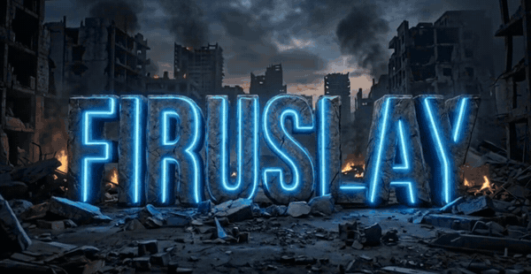

<div align="center">



# FIRUFLOW DLSS5

### Real-time GPU video enhancement for Windows

**Super resolution · Denoising · HDR · Frame generation · Capture · PS5 / Xbox / PC streaming**

The build behind [@firuflow](https://www.tiktok.com/@firuflow): one real-time GPU pipeline for local video, capture cards and game streaming.

<br>

[](#install)
[](#install)
[](LICENSE)
[](https://github.com/firufiruslay/FIRUFLOW-DLSS5/actions/workflows/windows-build.yml)

[](https://www.tiktok.com/@firuflow)

[**🐛 Report an issue**](https://github.com/firufiruslay/FIRUFLOW-DLSS5/issues)
&nbsp;·&nbsp;
[**📖 Full technical README**](README.old.md)
&nbsp;·&nbsp;
[**🇨🇳 简体中文**](README_CN.md)

</div>

<br>

---

## What this is

FIRUFLOW DLSS5 takes whatever picture reaches the PC — a video file, a capture card, a console
or a game stream — and enhances it on the GPU while it plays. Upscaling, denoising, HDR handling
and frame generation run in one pipeline, so the same settings apply to playback, recording and
export.

It is a fork of [Veyra NR](https://github.com/Likely7/Veyra-NRVideo) (GPL-3.0) by
[@likely2002](https://x.com/likely2002), rebranded and maintained for
[FIRUFLOW on TikTok](https://www.tiktok.com/@firuflow). The
engine is upstream's work; the credit for it stays with them. What changed here is the name and
the removal of the original author's donation and payment links — this build asks nobody for
money.

## Highlights

- **Enhancement that adapts per layer.** Each NR layer's enhancement delta reaches total strength
  5, with optional picture control (automatic or nine manual controls: hue, chroma, neutral tint,
  colour and lightness retention, shadows, highlights, local compression, temporal stability).
- **Node editing and layered NR.** Executable connections, independent NR and colour parameters
  per node, separate List and Node configurations, sessions and presets.
- **Every source in one place.** Files and images, capture cards, PS5, Xbox (experimental),
  Moonlight/Sunshine PC streaming and screen capture.
- **Backends.** SF310.9.16 performance and legacy models, NVIDIA original for RTX 50, AMD lmxxf,
  and DLSS / XeSS / FSR options.
- **Export queue.** Editable and ordered, with trimming, MP4/MKV, multiple audio and embedded
  subtitle tracks, cancellation and retry.
- **Interface.** Home, Cinema, Professional List, Nodes, Colour, Export and Settings, in
  Simplified and Traditional Chinese, English, Japanese and Korean.

## Install

Windows 11 x64 with DirectX 12. Qt and the approved runtimes ship with the package; GPU and
capture-card drivers are installed separately. Requirements depend on the backend — most upstream
testing ran on an RTX 5070.

This fork does not publish releases yet. Its reproducible package is built by the
[Windows build workflow](.github/workflows/windows-build.yml) on a clean GitHub runner: open a
run and download its portable ZIP artifact, then check it against the published `SHA256SUMS`.

```
gh attestation verify <zip> -R firufiruslay/FIRUFLOW-DLSS5
```

Start with the effects off, confirm picture and sound, then enable them one at a time. High
resolution, layered NR and frame generation all raise GPU and VRAM use.

## Using it

Home offers files, capture card, PS5, PC, Xbox and screen capture; files and images can be
dropped straight into the window. Move to the bottom edge to switch between Home, Cinema,
Professional, Colour, Export and Settings.

- **Cinema** puts the picture first, with a floating source, transport, audio and fullscreen bar.
- **Professional List** adds Picture, Frame generation, Colour, Sound and Display tabs, plus
  panels reporting source and output format, GPU stage time and load.
- **Node mode** builds the processing chain explicitly: disconnected drafts do not execute.
- Click the picture to pause, arrows seek five seconds, `Ctrl+L` locks the controls. Shortcuts
  are configurable.

The long version of all of this, written by upstream, is in [README.old.md](README.old.md).

## Build from source

Windows only. `CMakeLists.txt` returns early on every other platform, so there is no macOS or
Linux build of the player — only the OBS filter under `linux/obs`.

You need MSVC 2022, Qt 6.8.3 (`msvc2022_64`), the Windows SDK with D3D12 and the NVIDIA NGX SDK;
FFmpeg is built from source by vcpkg at the pinned baseline in `vcpkg.json` with the patches in
`scripts/ffmpeg/`. [`docs/DEVELOPMENT.md`](docs/DEVELOPMENT.md) carries upstream's entry points,
and its `E:/` paths describe the original author's machine, not yours.

The workflow in [`.github/workflows/windows-build.yml`](.github/workflows/windows-build.yml) is
the reference build: it fetches every dependency from its upstream source at a pinned commit and
produces the portable ZIP, its checksums and a signed provenance attestation.

## Licence and credit

Original code is GPL-3.0. The combined Chiaki streaming application is also subject to AGPL-3.0
and its OpenSSL exception (`licenses/remoteplay`). Third-party sources, pinned commits and
per-file modifications are recorded in [THIRD_PARTY_NOTICES.md](THIRD_PARTY_NOTICES.md).

Upstream: [Likely7/Veyra-NRVideo](https://github.com/Likely7/Veyra-NRVideo) ·
creator [@likely2002](https://x.com/likely2002) ·
[tutorials](https://www.youtube.com/watch?v=ZJ42jzNAbik). Keeping that credit is what the licence
requires, and it is where the engine comes from.

## Support

Open an [issue](https://github.com/firufiruslay/FIRUFLOW-DLSS5/issues). There is nothing to buy,
no account, and no donation link: this build is free software and stays that way.
